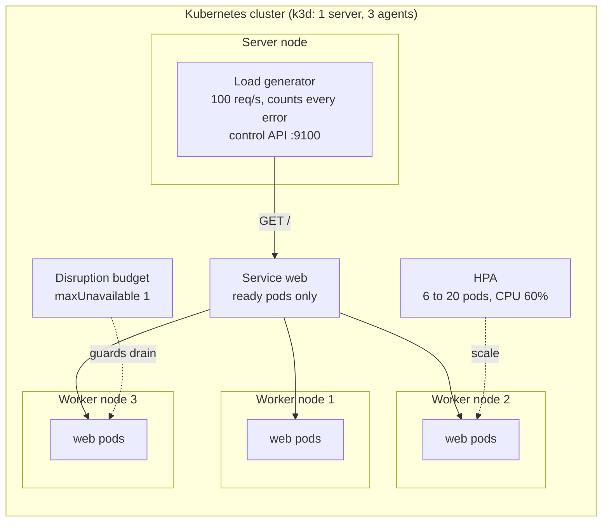

# Architecture: zero downtime under load

This document describes what the code and manifests in this repository do and why they are shaped this way. Component names match the diagram in the lesson ("Zero downtime under load"): **Load generator (client)**, **Service web**, **HPA**, **Pods** on **Worker node 1, 2 and 3**, and the **Disruption budget**, all in one **Kubernetes cluster**.

## Components and what each owns

| Component | Where it lives | What it owns |
| --- | --- | --- |
| **Load generator (client)** | Deployment `loadgen`, image `zero-downtime-loadgen`; code in [`src/loadgen`](src/loadgen) | Sends requests at a fixed rate from inside the cluster, classifies every outcome (connection error, timeout, 5xx, other non-2xx) and keeps latency percentiles. Its control API (`/stats`, `/reset`, `/rate`) is how the scripts and tests read the verdict. |
| **Service web** | [`manifests/base/web.yaml`](manifests/base/web.yaml) | A stable name (`web:80`). kube-proxy on every node routes it to the **ready** pods; how fast that list changes when a pod starts or stops is the whole subject of the lesson. |
| **Pods** | Deployment `web`, image `zero-downtime-web`; code in [`src/zero_downtime`](src/zero_downtime) | A one-second warm-up before the port opens, then 50 to 200 ms per request (2 ms of it computing), `/healthz` and `/readyz`, graceful shutdown on SIGTERM. |
| **HPA** | [`manifests/overlays/production/hpa.yaml`](manifests/overlays/production/hpa.yaml) | Replica count, 6 to 20, to hold average CPU at 60% of the request. Owns `spec.replicas` once the production overlay is applied. |
| **Disruption budget** | [`manifests/overlays/production/pdb.yaml`](manifests/overlays/production/pdb.yaml) | At most one web pod voluntarily unavailable at a time (drains, evictions). |
| **Worker nodes 1 to 3** | [`cluster/k3d-config.yaml`](cluster/k3d-config.yaml) | Three agent nodes plus a server node, which is tainted so that no web pod runs there. The load generator is pinned to the server node, which is never drained, so draining an agent cannot disturb the thing that counts errors. |
| **The four operations** | [`scripts/rollout-under-load.sh`](scripts/rollout-under-load.sh), [`scripts/drain-busiest-node.sh`](scripts/drain-busiest-node.sh), `make rate`, and [`tests/e2e`](tests/e2e) | A rolling update, a traffic spike, a node drain, a scale-down. |

## Pattern: ports and adapters in two programs, stages as overlays

There are two programs and they share no code (import-linter enforces it): the service and the load generator ship in different images, and a service that imported its own load generator would be testing itself.

**The service** keeps what it decides in `domain` (a request profile: latency bounds and how much of it is computing) and `application` (`HandleRequest`, `WarmUp`), behind three ports (`Randomness`, `Waiter`, `Burner`). `infrastructure` supplies the real clock, `time.sleep` and a busy loop; the unit tests supply fakes, so no test sleeps. `interfaces` is Flask plus the composition root.

**The load generator** keeps the interesting logic pure: `Pacer` (a fixed-rate, open-loop schedule that never lets a slow response delay the next send), `StatsWindow` (thread-safe counters and nearest-rank percentiles) and `Outcome`. `LoadRunner` in `application` drives the pacer through a `Clock` and an `Executor` port, so its tests run on a fake clock with no threads. `infrastructure` has the HTTP requester and thread pool; `interfaces` has the control API and the program.

The manifests are the lesson's steps as a chain of overlays, each adding only what that step teaches: `naive` (step 1), `graceful` (readiness, preStop, grace period), `rolling-tuned` (surge and unavailable), `production` (autoscaler, budget, spread). `tests/policy` proves that each overlay differs from the one before it only in those fields.

## Data flow

### One rollout under load, step by step (`make run`)

1. `scripts/loadctl.sh reset` port-forwards to the load generator and resets its counters. The generator has been sending 100 requests a second through `web.zero-downtime.svc`, each on a new connection, so each one meets whichever pod kube-proxy picks.
2. `kubectl rollout restart deployment/web` changes the pod template. The Deployment creates up to two extra pods (`maxSurge: 25%` of six, rounded up) and removes none until each new pod is ready (`maxUnavailable: 0`).
3. A new pod starts. gunicorn runs the app factory first, which waits out the one-second warm-up **before gunicorn opens its socket**. The kubelet probes `/readyz` every two seconds; connections in that window are refused, so the Service must not know the pod yet. Only after the first success does the pod join the Service's endpoints.
4. When a new pod is ready, the Deployment picks an old pod to remove. The API server sets its deletion timestamp, which does two things at once: the endpoints controller removes the pod from the Service, and the kubelet starts shutting the pod down. These are separate processes and neither waits for the other.
5. The kubelet runs the `preStop` hook, a fifteen-second sleep. During it the container still serves, which gives the endpoint removal time to reach kube-proxy on every node, including the node the load generator runs on. Requests that were already routed to the pod, or that a stale rule still sends, are answered.
6. Then the kubelet sends SIGTERM. gunicorn stops accepting, answers the requests in flight (up to its 10-second graceful timeout) and exits. If anything were still running when the 40-second grace period ended, SIGKILL would end it, and the load generator would count the cut-off requests.
7. After the last pod is replaced, the script waits eight seconds more and reads the counters. The verdict is `errors: 0`.

## Decisions and trade-offs

**The load generator runs in the cluster, one new connection per request.** `kubectl port-forward` tunnels to one pod, so a rollout that replaces that pod would look like an outage and every other pod would see no traffic. In the cluster the traffic goes through the Service like any client's. A new connection per request (as the lesson's `load.py` does) means every request meets a fresh routing decision; with keep-alive connections the failures would depend on how long clients hold connections, which is a different lesson.

**Open-loop pacing and `skipped`.** A closed loop (send the next request when the last answers) slows down exactly when the system struggles and hides the failures. `Pacer` fixes the send times in advance. If every sender thread is busy when a request is due, the request is counted as `skipped` rather than queued, and a result with `skipped > 0` is not a valid verdict about the service; the tests assert it is zero.

**`late_starts` and the source-port rule.** The generator also counts requests that started more than 0.1 s after they were due (its own threads were held up); a window with late starts is void and the cluster test measures it again. And it never reuses a source port that failed within the last 125 seconds: Linux remembers, for 120 seconds, which pod the Service chose for a half-open connection, so a later connection from the same port goes to the same dead pod and times out too. That is an artifact of an earlier failure, not a property of the step being measured; before this rule the graceful step lost 0.1 to 0.4% of its requests for two minutes after the naive step.

**Counting by class.** `connection` (refused, reset, remote closed), `timeout`, `http_5xx` and `http_other` are counted separately, not as a success rate. The naive rollout's errors are almost all `connection`; a 502 from an ingress would be `http_5xx`.

**The warm-up happens before the port opens.** With `gunicorn --preload`, the app factory (and its one-second delay) runs in the master before the listening socket exists, so the port refuses connections for that second, the same as a process that has not started listening. Without `--preload`, the socket would be open and connections would wait in the kernel's queue for the second, hiding the bug the lesson wants to expose. `tests/integration` checks that the port refuses connections during the delay and then serves.

**`preStop` with the native `sleep` action.** Kubernetes 1.30 and later can sleep without a shell or a `sleep` binary in the image. The sleep must outlast the propagation of an endpoint removal to every node's kube-proxy. On an idle machine one or two seconds is enough, and the first version of this project used five; on a busy laptop (a load average above ten) five seconds was measured to be too short: rollouts then lost a handful of requests to timeouts against pods that had already gone, and a node drain lost over two hundred. Fifteen seconds removed them, so that is the value here. A larger cluster or a service mesh needs a value measured the same way.

**The grace period is 40 seconds.** It must cover the `preStop` sleep (15 s, which counts against the grace period) plus gunicorn's graceful timeout (10 s) plus margin. `tests/policy` reads the graceful timeout out of the `Dockerfile` and fails if the manifest's grace period is shorter than the sum.

**Rollout: `maxSurge: 25%`, `maxUnavailable: 0`.** Capacity never drops below six. The cost is up to eight pods for a short time. The test samples the Deployment's ready count every 0.4 seconds during the rollout and asserts it never reads below six.

**CPU requests and what the autoscaler sees.** Utilization is a percentage of the **request**, not the limit. Each web pod requests `150m`; each request computes for 2 ms (`CPU_WORK_MS`) on top of what Flask and gunicorn cost (about 3.6 ms of CPU in all, measured), so at 100 requests a second across six pods the average sits near 40% of the request, under the 60% target, and at three times that load it goes well over, which is what makes the autoscaler respond. (A first version requested `100m`, which put the baseline at 60%, exactly on the target: no headroom and the autoscaler went to its maximum of 20 pods on the spike.) A service that only slept would use no CPU and never scale. The scale-up policy allows doubling every 15 seconds; scale-down waits 60 seconds of stable low load and then removes at most two pods every 30 seconds (the default is five minutes, which would make the last step of the lesson ten minutes long).

**`maxUnavailable: 1` for the disruption budget**, not `minAvailable: 5`. The autoscaler changes the replica count between 6 and 20; a fixed minimum is right at only one of those counts. "At most one down" is right at every count.

**Topology spread with `nodeTaintsPolicy: Honor`.** Without it, the control-plane node (tainted, so no web pod can run there) counts as a domain with zero pods, and `maxSkew: 1` then allows each worker only one pod. A cordoned node during a drain does the same. `Honor` leaves tainted and cordoned nodes out of the calculation. `matchLabelKeys: [pod-template-hash]` makes the spread count each ReplicaSet's pods separately, so a rolling update spreads the new pods as evenly as the old ones.

**The autoscaler owns `replicas`.** The production overlay removes `spec.replicas` from the Deployment. A manifest that states it would reset the count to six every time it is applied.

**Security context everywhere**, as in the other repositories: non-root, `RuntimeDefault` seccomp, no privilege escalation, all capabilities dropped, read-only root filesystem with a small `emptyDir` at `/tmp`, no mounted service-account token, and the `restricted` Pod Security standard enforced on the namespace.

## Failure modes the lesson teaches, and how to reproduce each

| Failure | What you see | Reproduce |
| --- | --- | --- |
| No readiness probe | A new pod receives traffic during its warm-up second; the port refuses connections; `connection` errors. | `make deploy OVERLAY=naive`, then `make run` |
| No `preStop` delay | Pods leave the Service and stop at the same moment; requests still routed to them are refused. | Remove the `lifecycle` block from the `graceful` overlay, then `make run` |
| Grace period shorter than `preStop` plus the longest request | SIGKILL arrives mid-request; `connection` errors or `timeout`s. | Set `terminationGracePeriodSeconds: 5` in the `graceful` overlay |
| Capacity dips during a rollout | `READY` drops below six; with real load, latency rises. | `make deploy OVERLAY=graceful`; watch `kubectl get deployment web -w` during `make run` |
| Requests not scaled to CPU | The HPA shows `<unknown>` (no metrics-server) or never reaches its target (request too high). | Delete the bundled metrics-server deployment, or raise `requests.cpu` |
| Pods piled on one node | One drain removes half the service at once. | Delete the `topologySpreadConstraints` patch from the `production` overlay, then `make drain` |
| No disruption budget | A drain evicts every pod on the node together. | Delete `pdb.yaml` from the `production` overlay, then `make drain` |

## Limits of the teaching build against production

- **A single machine.** The "nodes" are containers sharing one host's CPU, memory and network, so absolute latencies and the autoscaler's timing depend on what else the machine is doing. The zero-error outcomes after the fixes do not.
- **Endpoint propagation is fast here.** Fifteen seconds of `preStop` is generous for four nodes on an idle machine; a large cluster, a service mesh or a cloud load balancer that must deregister targets needs a longer one (30 seconds is common behind some load balancers).
- **One Service, no ingress.** A real deployment has a load balancer or ingress between the clients and the pods, with its own connection draining and idle timeouts to line up with these.
- **No keep-alive.** Real clients reuse connections; closing them gracefully on shutdown (`Connection: close` during drain) is a further step.
- **CPU-based scaling only.** Requests per second or queue depth are better signals for a service like this; the stretch goal mentions it.
- **No stateful work.** Pods hold nothing in memory that must survive; a service with sessions or open streams needs more than a delay.

## How to extend it

- **A startup probe:** add `startupProbe` to the `production` overlay and set `STARTUP_DELAY_SECONDS=30`; compare with a liveness probe alone, which would kill the pod during its warm-up.
- **A different latency profile:** set `LATENCY_MIN_MS`, `LATENCY_MAX_MS` and `CPU_WORK_MS` in `manifests/base/web.yaml`; `RequestProfile` validates them.
- **A different signal for scaling:** replace the `metrics` block in `hpa.yaml` with a `Pods` or `External` metric and install the adapter that serves it.
- **More error classes:** add a member to `Outcome` in `src/loadgen/domain/outcome.py`, classify it in `HttpRequester._attempt`, and count it in `StatsWindow._build`.
